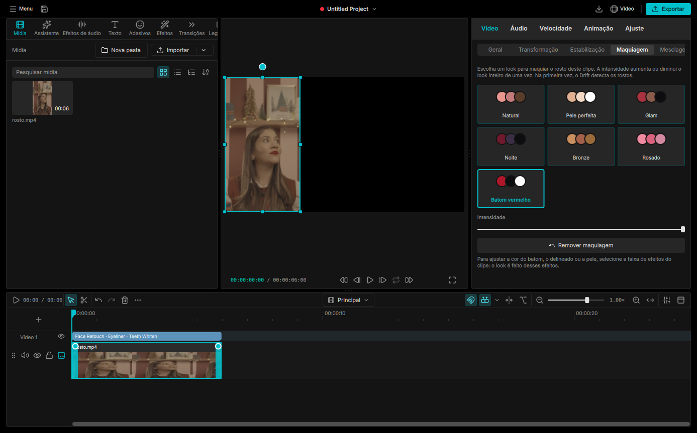

# Atualização para o Drift oficial 0.8.0

Feita em 2026-10-16, no ramo novo `capcut-080` (commit de mesclagem `7f2b2a60`). O ramo `capcut-style` ficou intacto, como estava em 15/10, e é para onde voltar se algo der errado.

## O que foi feito

Mesclagem completa do `main` oficial (426 commits, versões 0.6, 0.7, 0.7.5 e 0.8.0) sobre o nosso ramo, mantendo o visual CapCut e as nossas funções. Foram 44 arquivos em conflito.



## O que entrou do oficial

- **Face Retouch completo, com batom e blush** sobre a malha `face111`: era o motivo da atualização. O look "Batom vermelho" agora pinta os lábios ([recorte](20-drift-080-batom.png)).
- Proxy de edição (vídeos 4K leves), com os proxies guardados ao lado do original.
- Edição pela transcrição (palavra por palavra, quem fala, cortes pelo texto).
- Mixer de áudio novo, barra de narração, efeitos de áudio em cadeia com quadros-chave, voz sintetizada local (aba "Fala").
- Efeitos por profundidade (desfoque de fundo, nova luz 3D, neblina, oclusão), efeito Contorno.
- Clipes 3D, câmera de cena, camada de transformação.
- Texto editado direto no preview, fontes do sistema, novo desenho de texto (SkParagraph).
- Vídeo com transparência, GIF como vídeo, sequência de imagens, PDF.
- Clipe composto oficial ("composite"), com seletor de timelines ("Principal") na barra da timeline.
- Conjuntos de guias no preview, com arrastar e encaixe.
- Barra da timeline configurável, abrir projeto sem travar, correções das três versões.

## O que ficou nosso

- **Visual CapCut:** tema, barra de título (Menu, nome no centro, Exportar), abas no topo do painel da esquerda, seções Vídeo/Áudio/Velocidade/Animação/Ajuste no painel de propriedades. O painel de propriedades agora usa a lista de abas nova do oficial; Maquiagem e Ajuste aparecem por uma capacidade nova, `pictured` (vídeo e imagem).
- Ímã da faixa principal, travar faixa, corte roll (Ctrl ao aparar), juntar em um só clipe, exportar clipes selecionados, remover pausas, sugestões inteligentes, gravação de microfone, tela e câmera, revincular mídia perdida, cortar trecho de tempo, fechar todos os espaços.
- Assistente (Ollama e ponte do Claude), legendas com IA, cortes curtos, enchimento e repetições, aprimorar qualidade, looks de maquiagem, correções de CUDA.
- Prévia de rede social (TikTok, Shorts, Reels): agora escolhida no menu de guias do preview, em "Prévia de rede social".

## Onde os dois fizeram a mesma coisa

| Função | Ficou |
|---|---|
| Link de clipes | O do oficial, que é o nosso aceito no PR #200, já com aparar juntos |
| Soltar arquivos do gerenciador na timeline | O do oficial (mostra o contorno durante a importação) |
| Guias no preview | O do oficial (conjuntos de guias) |
| Decodificador compartilhado e liberação de ociosos | O do oficial |
| Clipe composto | O do oficial; o nosso ficou escondido (projetos antigos com ele continuam abrindo, com a barra "Voltar" e as abas) |

## Testes

Suítes no ramo novo: núcleo 171, editor 235, agente 152 de 153, motor 235 (todas maiores que antes, pelos testes novos do oficial). Duas falhas, ambas em código do oficial que não mexemos: `authoredEffectLifecycle` (exportar e reimportar um efeito `.driftfx`) e `nvdecAv1StaysOnHardware` (o decodificador NVIDIA recusa vídeo AV1 nesta placa: pede 41 superfícies de decodificação, o limite é 32). Nossas mudanças antigas nessa área (dispositivo de vídeo compartilhado, limite de decodificadores ociosos) ficaram sem uso, porque valem as do oficial.

Conferido na tela, em português: barra CapCut, aba Maquiagem, look Batom vermelho com os lábios pintados, faixa de efeitos do clipe.

## Pendências

1. **Clipe na timeline agora é desenhado em C++** (`src/timeline/TimelineTrackItem.cpp`). Nossos ajustes que eram em QML no corpo do clipe (linha de volume arrastável, tamanho da forma de onda 30/60/100%) precisam ser refeitos lá.
2. **Cabeçalho:** ficou o nosso. Do oficial ficaram de fora a busca geral (Ctrl+K), o sino de notificações e o aviso de exportação feita pelo agente.
3. **Réguas e guias nossos** compilam, mas não aparecem mais no preview; as guias do oficial cobrem o uso. Decidir se saem de vez.
4. **Memória da placa com muitos vídeos 4K:** agora vale a solução do oficial; conferir no uso real.
5. Duplo clique para entrar num clipe composto antigo saiu junto com o tratamento de mouse antigo (usar a aba).

## Instalação e GitHub

Instalado nos ramos master e stable do Flatpak local em 16/10 (commit stable `9cf069df`).

O envio do ramo `capcut-080` ao GitHub foi recusado: os commits do oficial alteram arquivos de automação (`.github/workflows`), e o token de acesso deste PC não tem a permissão `workflow`. Para enviar, gerar um token com essa permissão (GitHub › Settings › Developer settings › Personal access tokens, marcar `workflow`) e atualizar a credencial salva, ou passar a usar SSH. Depois: `git push fork capcut-080` na pasta `Drift-link`.

## Como voltar

Sem recompilar, voltando o pacote instalado para o de 15/10 (o repositório local guarda o histórico):

```bash
flatpak update --user -y --commit=71fa5732ee7a73ee23227521c343267f244d39d867a9771a5824c4e9fe153fa4 org.cutwire.Drift//stable
```

(ramo master: `--commit=f8874df767239ea4b5049b6d308232736d421daf7417a75519795f93a005d78e`). Para mexer no código antigo: `git switch capcut-style` no `Drift-link`.
